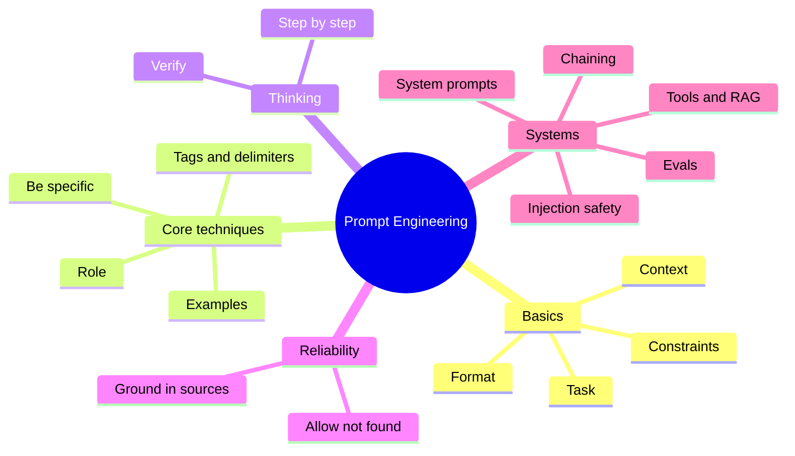
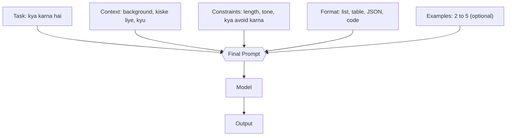
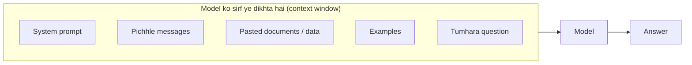
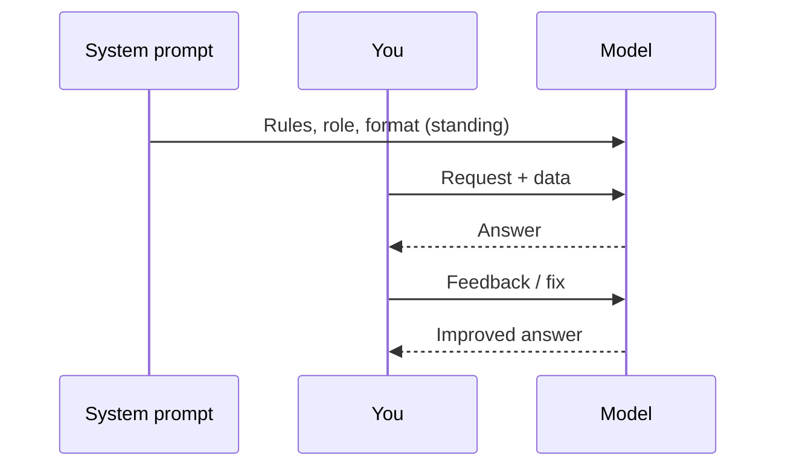
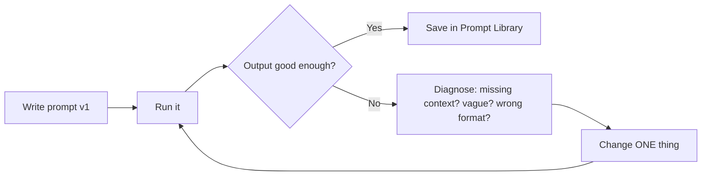
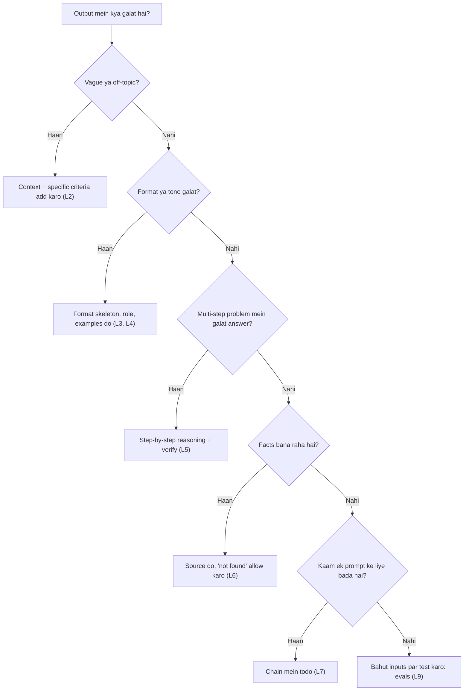
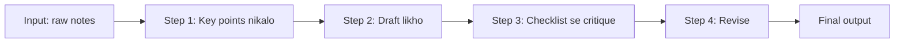
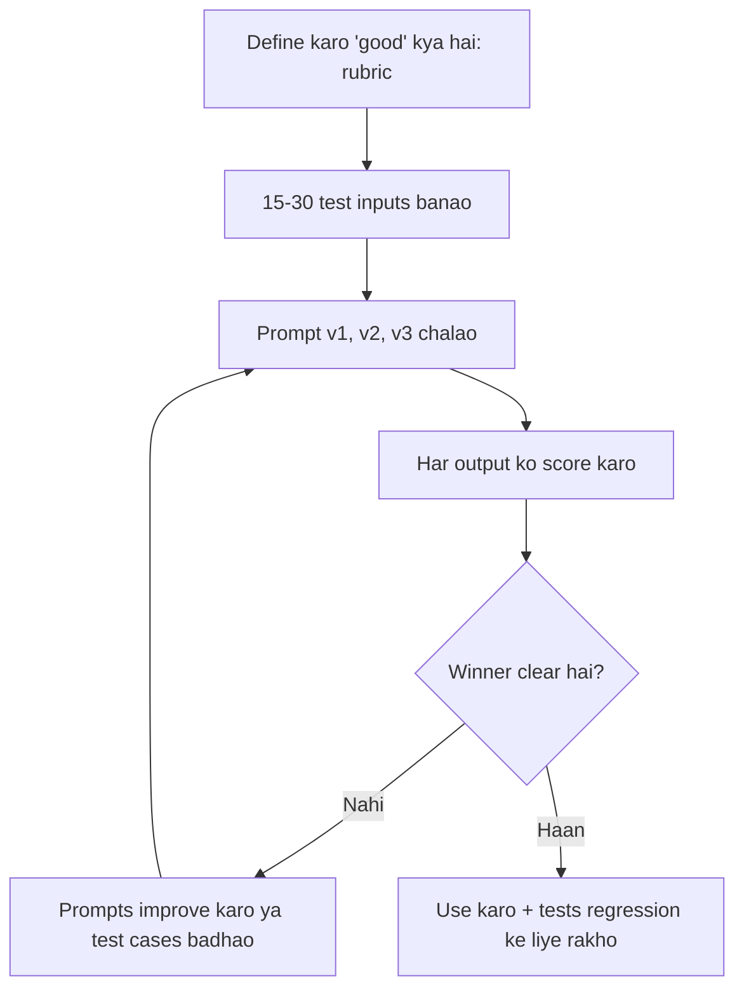
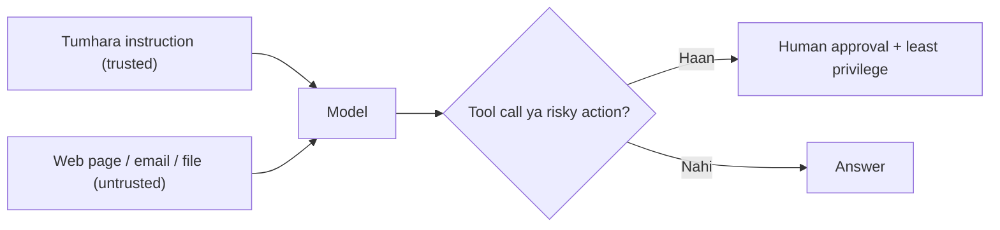

# 🖼️ Diagrams & Maps

⬅️ [[00 START HERE]]

**EN:** All diagrams use Obsidian's built-in Mermaid. If a block shows an error, tell me and I'll fix it.
**Hinglish:** Saare diagrams Mermaid mein hain. Obsidian mein apne aap render honge. Visual canvas map: [[Learning Map.canvas|Learning Map]].

---

## 1. Poora topic ek nazar mein (mind map)

## 2. Ek prompt ke hisse (Level 1–3)

## 3. Model ko kya dikhta hai (context window)

**Takeaway:** jo cheez context mein nahi, wo model ke liye exist nahi karti (jab tak app memory/tools na de).

## 4. Chat ka flow (roles)

## 5. Iteration loop (Level 2, sabse zaruri habit)

## 6. Kaunsa technique kab (decision tree)

## 7. Prompt chain (Level 7)

## 8. Eval loop (Level 9)

## 9. Safety: trusted vs untrusted text (Level 10)

**Takeaway:** untrusted text mein chhupe instructions model ko bhatka sakte hain. Sirf prompt likhkar ye problem poori tarah solve nahi hoti; permissions aur approvals bhi chahiye.
