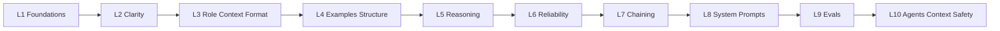

# 🧭 Prompt Engineering Complete Course

**A free, self-paced prompt engineering course for beginners, in English and Hinglish.**
10 levels, a copy-paste Prompt Book, verified GitHub resources, and diagrams. Built as an [Obsidian](https://obsidian.md) vault, and readable on GitHub as plain Markdown.

> **Hinglish:** Ye beginners ke liye free, self-paced Prompt Engineering course hai. Har lesson mein **English aur Hinglish dono** hain, taaki jo jaldi samajh aaye wahi padho.

---

## Who is this for?

- You use AI chat tools but your prompts give average results.
- You want a clear path from **Level 1 (basics)** to **Level 10 (agents, evals, safety)**.
- You understand English, Hinglish, or both.

## What you get

| Part | What's inside |
|---|---|
| **10-level course** | Concepts, worked examples, exercises, a mini-project and a pass test for every level |
| **Prompt Book** | Master template, learning / coding / meta templates, common mistakes, cheat sheet, glossary |
| **Roadmap tools** | Placement test, 30-day plan, progress tracker |
| **Resources** | Top GitHub repos and free courses, with notes on what was verified |
| **Diagrams** | 9 Mermaid diagrams (these render on GitHub) and an Obsidian Canvas map |

---

## Quick start

**Read on GitHub**
1. Start with [`00 START HERE.md`](00%20START%20HERE.md).
2. Take the [Placement Test](01%20Roadmap/Placement%20Test.md) to find your level.
3. Follow the [10-Level Roadmap](01%20Roadmap/10-Level%20Roadmap.md) or the [30-Day Plan](01%20Roadmap/30-Day%20Plan.md).

**Use in Obsidian (recommended)**
```bash
git clone https://github.com/princeroyal-dev/-prompt-engineering
```
Then in Obsidian choose **Open folder as vault** and select the cloned folder. The `[[wikilinks]]`, graph view and `Learning Map.canvas` work there. On GitHub the wikilinks are not clickable, so use the links in this README instead.

---

## Course map



| Level | Topic | You will be able to |
|---|---|---|
| 1 | [Foundations](02%20Course/Level%2001%20-%20Foundations.md) | Write a 4-part prompt: Task, Context, Constraints, Format |
| 2 | [Clarity and Specificity](02%20Course/Level%2002%20-%20Clarity%20and%20Specificity.md) | Turn vague requests into measurable ones; use the iteration loop |
| 3 | [Role, Context and Format](02%20Course/Level%2003%20-%20Role%20Context%20and%20Format.md) | Control who the AI is and the exact shape of the output |
| 4 | [Examples and Structure](02%20Course/Level%2004%20-%20Examples%20and%20Structure.md) | Use few-shot examples and XML-style tags |
| 5 | [Reasoning and Thinking](02%20Course/Level%2005%20-%20Reasoning%20and%20Thinking.md) | Get better multi-step answers and verify them |
| 6 | [Reliability and Hallucinations](02%20Course/Level%2006%20-%20Reliability%20and%20Hallucinations.md) | Ground answers in sources; make the model say "not found" |
| 7 | [Chaining and Complex Tasks](02%20Course/Level%2007%20-%20Chaining%20and%20Complex%20Tasks.md) | Split big jobs into prompt chains |
| 8 | [System Prompts and Apps](02%20Course/Level%2008%20-%20System%20Prompts%20and%20Apps.md) | Write system prompts; version prompts like code |
| 9 | [Evals and Testing](02%20Course/Level%2009%20-%20Evals%20and%20Testing.md) | Pick the best prompt with scores, not feelings |
| 10 | [Agents, Context and Safety](02%20Course/Level%2010%20-%20Agents%20Context%20and%20Safety.md) | Use tools and RAG safely; handle prompt injection |

Every level note has an **English** section and a **Hinglish** section.

---

## Prompt Book

Start at the [Prompt Book Index](03%20Prompt%20Book/Prompt%20Book%20Index.md).

- [Anatomy and Master Template](03%20Prompt%20Book/Anatomy%20and%20Master%20Template.md)
- [Templates: Learning](03%20Prompt%20Book/Templates%20-%20Learning.md) (zero-to-pro teacher, quiz, flashcards, study plan)
- [Templates: Coding](03%20Prompt%20Book/Templates%20-%20Coding.md) (debug, review, explain, safe command helper)
- [Templates: Meta](03%20Prompt%20Book/Templates%20-%20Meta.md) (improve your own prompts)
- [Mistakes and Fixes](03%20Prompt%20Book/Mistakes%20and%20Fixes.md)
- [Cheat Sheet](03%20Prompt%20Book/Cheat%20Sheet.md)
- [Glossary](03%20Prompt%20Book/Glossary.md)

---

## Resources

- [GitHub Top Resources](04%20Resources/GitHub%20Top%20Resources.md): how each repo maps to the levels, plus honest caveats.
- [Free Courses and Docs](04%20Resources/Free%20Courses%20and%20Docs.md): official guides and free courses.
- [Diagrams](05%20Diagrams/Diagrams.md): mind map, prompt anatomy, iteration loop, decision tree, chains, evals, safety.

Main repos linked in the course (checked 2026-10-17):

| Repo | Why it's useful |
|---|---|
| [anthropics/prompt-eng-interactive-tutorial](https://github.com/anthropics/prompt-eng-interactive-tutorial) | Hands-on tutorial: 9 chapters + appendix with exercises |
| [anthropics/courses](https://github.com/anthropics/courses) | Five courses: API basics, prompting, real-world prompts, evaluations, tool use |
| [dair-ai/Prompt-Engineering-Guide](https://github.com/dair-ai/Prompt-Engineering-Guide) | Large open guide to techniques, applications and risks (MIT) |
| [promptslab/Awesome-Prompt-Engineering](https://github.com/promptslab/Awesome-Prompt-Engineering) | Curated list of papers, tools and courses |
| [thinkingjimmy/Learning-Prompt](https://github.com/thinkingjimmy/Learning-Prompt) | Free beginner course that explains the "why" |

---

## Repository structure

```text
.
├── 00 START HERE.md
├── 01 Roadmap/        # roadmap, placement test, 30-day plan, progress tracker, canvas map
├── 02 Course/         # Level 01 to Level 10 (English + Hinglish)
├── 03 Prompt Book/    # templates, cheat sheet, glossary, mistakes
├── 04 Resources/      # GitHub repos, free courses and docs
├── 05 Diagrams/       # Mermaid diagrams
└── README.md
```

## How to study

1. **Read** one level (English or Hinglish).
2. **Do** every exercise in any AI chat. The free plan of most tools is enough.
3. **Log** each experiment in [My Progress](01%20Roadmap/My%20Progress.md).
4. Move on only when the level's **pass test** boxes are ticked.

Change **one thing at a time** when you improve a prompt, otherwise you can't tell what helped.

---

## Honest notes

- This is a self-study course written for learning. It is **not** an official certification.
- Reading everything here is free. Running some linked notebooks (for example Anthropic's) needs an API key, which costs a little. You can copy the exercise prompts into a free AI chat instead.
- The linked Anthropic tutorial and courses use an older, low-cost model. The concepts still apply, but exact outputs differ on newer models.
- AI answers can be wrong. Always verify facts, links, numbers and code.
- Some resources in the lists were taken from curated lists and not opened one by one. The notes mark which is which.
- Prompt engineering changes fast. If something looks outdated, please open an issue.

## Contributing

Issues and pull requests are welcome, especially:
- Hinglish improvements and typo fixes
- New exercises or test cases
- Updated or broken resource links

## License

Add a `LICENSE` file before publishing. For course notes, a Creative Commons license such as [CC BY 4.0](https://creativecommons.org/licenses/by/4.0/) is a common choice. Linked third-party repos keep their own licenses.

---

⭐ If this helps you, star the repo and share it with a friend who is learning AI.
